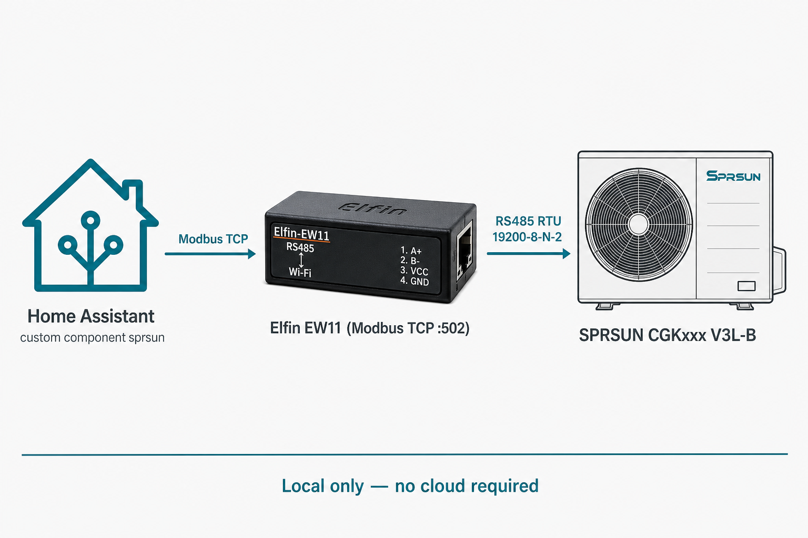
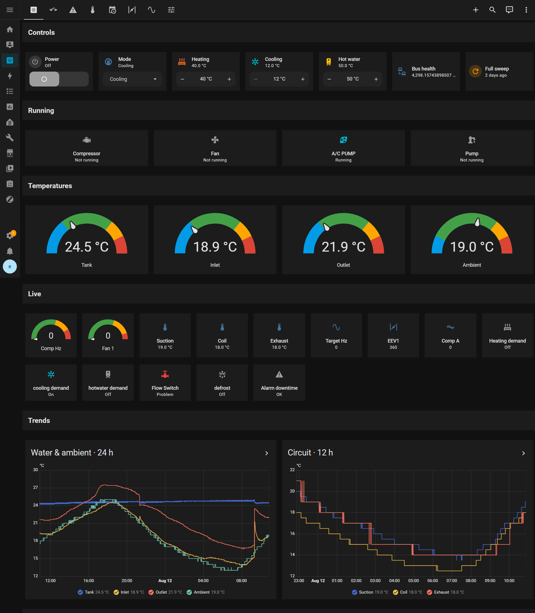

# SPRSUN for Home Assistant

Control a SPRSUN air-to-water heat pump from Home Assistant over your local
network. No vendor cloud account, no hosted app — just Home Assistant talking
Modbus TCP to a small RS485 bridge (often an Elfin EW11) that sits next to the
unit.

This targets SPRSUN monoblocks that use the vendor’s **self-developed wire
controller** and the matching Modbus map (the PDF in
[docs/registers/](docs/registers/)). If your unit uses a Carel-based map instead,
this integration will not fit — see [Compatibility](#compatibility).



A typical bridge looks like this Elfin EW11 (RS485 ↔ Wi‑Fi, Modbus TCP on your
LAN):


*Example photo from the [Home Assistant community](https://community.home-assistant.io/t/elfin-ew11/461842).*

| Requirement | Detail |
|-------------|--------|
| Home Assistant | 2024.6.0 or newer |
| Install path | HACS custom repository, or copy `custom_components/sprsun` by hand |
| Python package | `pymodbus` ≥ 3.6.0 (Home Assistant installs this for you) |
| Network | Modbus TCP, usually port **502** |
| Heat-pump serial | Modbus RTU **19200-8-N-2**, slave ID **1** (typical) |
| Current version | `0.2.7` |

---

## Why a custom integration?

Home Assistant already has a built-in `modbus:` platform. It can reach the same
gateway — but for a register map this large, that approach tends to fall apart
on real hardware.

Native YAML usually polls **one register per entity**. Point that at a few
hundred addresses and the EW11 (or similar half-duplex bridge) gets flooded:
timeouts, misframed replies, values that jump between identical reads, and
sometimes a gateway that only recovers after a power cycle. Many EW11 units
also keep a cloud relay on the same UART, so a second master is already
fighting you for the bus.

This integration was built for that reality. It reads the map in **block
reads** (a handful of FC3 requests instead of hundreds), keeps day-to-day
values on a fast “light” poll, and sweeps the full map on a slower cadence.
Soft failures reopen the TCP connection instead of spinning forever.

Use **either** this integration **or** a large native `modbus:` heat-pump
package — not both on the same gateway.

---

## What it looks like



The Overview above is from a live install: power and mode, setpoints, running
bits (compressor, fan, pumps), temperature gauges, live machine readings, and
trend graphs. The optional dashboard YAML also adds tabs for the rest of the
register map and a live log.

Day to day you can:

- Switch the unit on or off
- Choose mode (DHW, heating, cooling, or the combined modes)
- Set heating, cooling, and hot-water temperatures
- Watch tank / inlet / outlet / ambient and compressor frequency
- Browse the wider register map when you need it
- Force a full refresh or download the in-memory live log for debugging

---

## Compatibility

SPRSUN ships more than one control platform. **The nameplate alone is not
enough** — what matters is whether the unit speaks the same Modbus map as the
documents in [docs/registers/](docs/registers/) (vendor file
`RS485-CG248075-MODBUS-V1.2`, July 2022).

**Confirmed on hardware:** CGK030-V3L-B (also printed CGK-030V3L-B) — power,
mode, setpoints, temperatures, and block reads verified live.

**Expected to match** the chassis codes listed as F56 model selection in that
protocol PDF:

| F56 | Chassis | Typical nameplate |
|-----|---------|-------------------|
| 1 / 2 | A102508 / A202508 | CGK025 / CGK-025 |
| 3 / 4 | A103008 / A203008 | CGK030 / CGK-030 |
| 5 / 6 | A104008 / A204008 | CGK040 / CGK-040 |
| 7 / 8 | A105008 / A205008 | CGK050 / CGK-050 |
| 9 / 10 | A106008 / A206008 | CGK060 / CGK-060 |

Those are usually V3L / V3L-B (B-series) R32 monoblocks with SPRSUN’s own colour
wire controller. If your plate reads something like `CGK0xxV3L-B`, you are in
the right neighbourhood — still run the quick check below before trusting
writes.

**Maybe the same platform, not in the F56 1–10 list:** CGK015V3L-B and
CGK-080V3L-B show up on B-series datasheets. Treat them as unverified.

**Not this integration:** Carel-style maps (status around `@217`, temps
`@188–196`, coil `40`), many R290 community setups, older Carel-only
integrations, or any unit with no RS485 / Modbus path at all.

### Quick check

With Modbus TCP open to the gateway (port 502, slave 1):

1. Register **17** (ambient) should look plausible outdoors after ×0.5.
2. Register **54** (mode) should be 0–4 and match the panel.
3. Register **50** bit0 should match on/off.

If those line up, you are in good shape. If everything looks frozen or random,
stop — you likely have a different map.

---

## What you need

**Hardware:** a compatible heat pump, RS485 on the unit, and a Modbus TCP bridge
on your LAN (EW11 / EE11, ZLAN, ESP-based bridges, and similar all work in
principle). Home Assistant must be able to reach the bridge’s IP.

Match the bridge UART to the heat pump. On these units that is often:

```text
19200 baud, 8 data bits, no parity, 2 stop bits, slave ID 1
```

Stop bits **2** surprises people who expect 8-N-1 — check the EW11 UART page.

**Software:** Home Assistant 2024.6+, and HACS if you want one-click updates.
`pymodbus` arrives automatically with the integration. For the bundled Overview
layout, also install [layout-card](https://github.com/thomasloven/lovelace-layout-card)
from HACS → Frontend.

You do not need Node-RED, MQTT, or the phone app. If the EW11’s cloud relay is
still attached to the UART, consider detaching it — two masters on one RS485
bus is a common source of flaky reads.

Have ready: gateway IP (or hostname), TCP port (usually 502), and slave ID
(usually 1).

---

## Install

### HACS

1. Install [HACS](https://www.hacs.xyz/docs/use/download/download/) if needed.
2. **HACS → Integrations → ⋮ → Custom repositories**
3. Add `https://github.com/erhancm/ha-sprsun` as category **Integration**
4. Download **SPRSUN**, then restart Home Assistant
5. Add the YAML in [Configuration](#configuration) (there is no UI config flow yet)

You can also copy the component by hand (below) if you prefer not to use HACS.

### Manual copy

Copy `custom_components/sprsun` into your Home Assistant config so you have:

```text
/config/custom_components/sprsun/
```

Bring the whole folder (`data/`, `www/`, and the Python files). Skip
`__pycache__`. Restart Home Assistant, then configure as below.

---

## Configuration

Setup is YAML-only for now.

**1. Secrets** — `/config/secrets.yaml` (see [examples/secrets.example.yaml](examples/secrets.example.yaml)):

```yaml
modbus_host: "192.168.1.95"
modbus_port: 502
modbus_device_id: 1
```

**2. Integration** — `/config/configuration.yaml` (see
[examples/configuration.example.yaml](examples/configuration.example.yaml)):

```yaml
sprsun:
  host: !secret modbus_host
  port: !secret modbus_port
  slave: !secret modbus_device_id
  scan_interval: 5          # light overview poll (seconds)
  full_interval: 20         # full map sweep (seconds)
  message_wait_milliseconds: 350
  full_wait_milliseconds: 450
  max_block: 125
  register_limit: 413       # full map; lower if the gateway struggles
```

| Option | Default | Role |
|--------|---------|------|
| `host` | required | Gateway address |
| `port` | `502` | TCP port |
| `slave` | `1` | Modbus unit ID |
| `scan_interval` | `5` | Light poll (temps, power, mode, setpoints) |
| `full_interval` | `20` | How often to refresh the full active map |
| `register_limit` | `413` | How far into the map to go (1–413). Start smaller if the bus is unstable. |
| `message_wait_milliseconds` | `350` | Gap between light requests |
| `full_wait_milliseconds` | `450` | Gap during a full sweep |
| `max_block` | `125` | Max registers per FC3 read |

**3.** Check configuration under Developer tools, then restart.

**4.** You should see entities such as `switch.sprsun_power`,
`select.sprsun_mode`, the three setpoint numbers, temperature sensors, and
`sensor.sprsun_modbus_refresh`. On that last one, `kind` should alternate
`light` / `full` and `errors` should stay near zero.

**5. Recorder tip:** the live-log entity carries a fat `tail` attribute — exclude
it from history:

```yaml
recorder:
  purge_keep_days: 10
  exclude:
    entities:
      - sensor.sprsun_live_log
```

---

## Optional dashboard

The screenshot above comes from [examples/dashboard.sprsun.yaml](examples/dashboard.sprsun.yaml).

1. Install **layout-card** (HACS → Frontend)
2. Copy the file to `/config/dashboards/sprsun.yaml`
3. Add:

```yaml
lovelace:
  dashboards:
    lovelace-sprsun:
      mode: yaml
      title: SPRSUN
      icon: mdi:heat-pump
      show_in_sidebar: true
      filename: dashboards/sprsun.yaml
```

4. Restart and open **SPRSUN** in the sidebar

---

## Services

| Service | What it does |
|---------|----------------|
| `sprsun.set_power` | On/off (register 50 bit0, read-modify-write) |
| `sprsun.set_mode` | Mode 0–4 or a name like `Heating` |
| `sprsun.write_register` | Raw FC6 — use sparingly |
| `sprsun.refresh_full` | Immediate full map sweep |
| `sprsun.dump_live_log` | Write the live log on the HA host under `/config/` |
| `sprsun.download_live_log` | Notification with a short-lived browser download |
| `sprsun.clear_live_log` | Empty the in-memory log |

---

## Registers

The vendor protocol PDF, a text extract, parsed JSON, and a short day-to-day
table are in [docs/registers/](docs/registers/). Start with `key-registers.md`
if you only need power, mode, setpoints, and the main temperatures.

---

## Troubleshooting

| Symptom | Things to try |
|---------|----------------|
| Nothing appears after restart | Check YAML indent and secret names; confirm `custom_components/sprsun` is present; search the log for `sprsun` |
| `modbus_refresh` errors climbing | Raise the wait times, lower `register_limit`, and make sure only one master is polling |
| Values look wrong or stuck | Wrong map — revisit [Compatibility](#compatibility) |
| Writes report success but nothing changes | Confirm you are on this map (not Carel coil 40); check panel alarms; confirm you are alone on the bus |
| EW11 gets flaky | Stay on this block-read path; detach cloud UART relay if you can |
| Entities ending in `_2` | Remove an old native `modbus` heat-pump package, delete orphans, restart |

Again: do not run a large built-in `modbus:` package alongside `sprsun:` on the
same gateway.

For everyday use, prefer the power / mode / setpoint entities over raw
`write_register`. Calibration and model-selection registers can misconfigure the
unit — leave them alone unless you know exactly what you are changing. Avoid
bulk “reset everything” scripts.

---

## For maintainers

```text
ha-sprsun/          ← public GitHub / HACS repo (this tree)
├── README.md
├── LICENSE / NOTICE / hacs.json
├── brand/icon.png
├── custom_components/sprsun/
├── docs/images/
├── docs/registers/
└── examples/
```

This public tree is a **slice** of a larger private research repo (scripts,
Arduino, verification dumps, and long-form notes stay there). Sync from the
monorepo with `python scripts/sync_github_hacs.py` when you change the
component.

Public repo: [github.com/erhancm/ha-sprsun](https://github.com/erhancm/ha-sprsun).
Tag releases so HACS can update (`v0.2.7` ↔ `version` in `manifest.json`).

---

## License

Apache License 2.0 — see [LICENSE](LICENSE) and [NOTICE](NOTICE).

SPRSUN is a trademark of its respective owner. This is an unofficial community
project and is not affiliated with or endorsed by Guangzhou Sprsun New Energy
Technology Development Co., Ltd.
